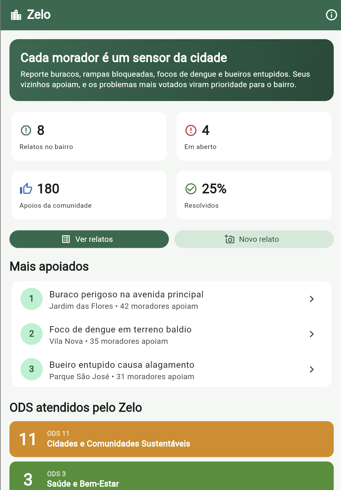
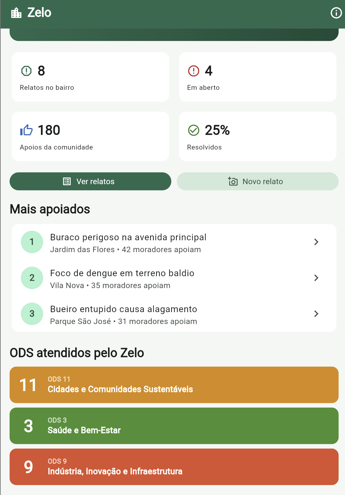
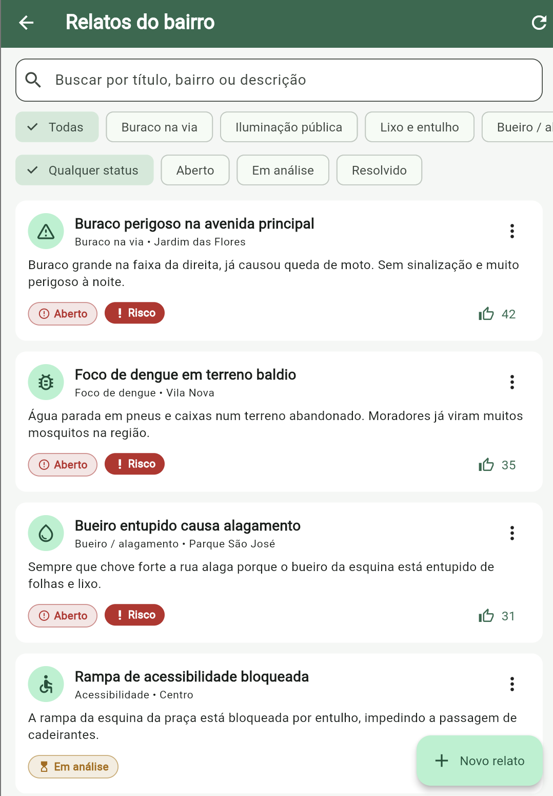
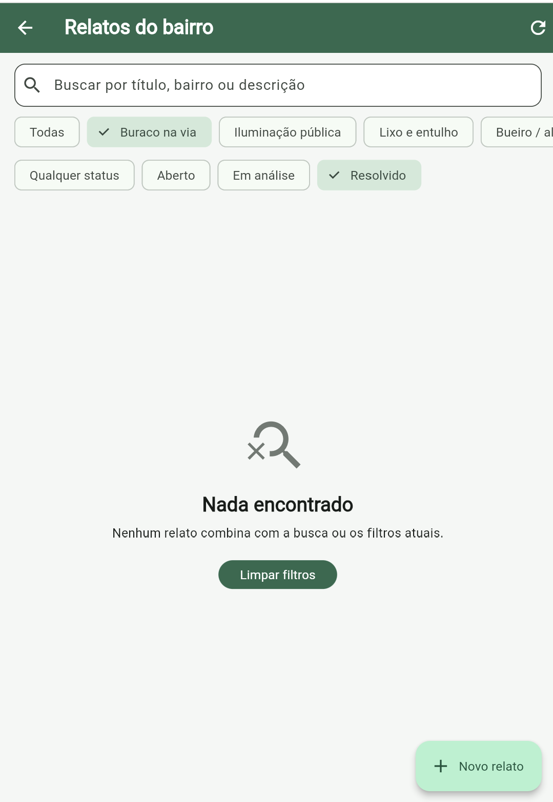
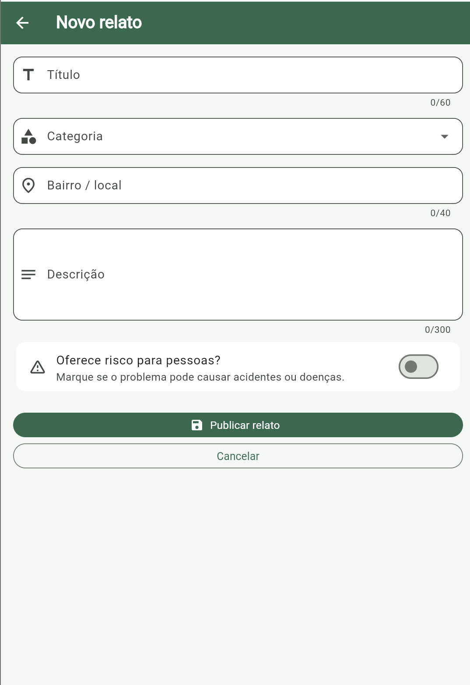
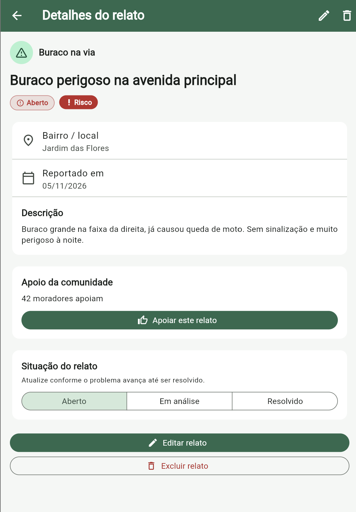
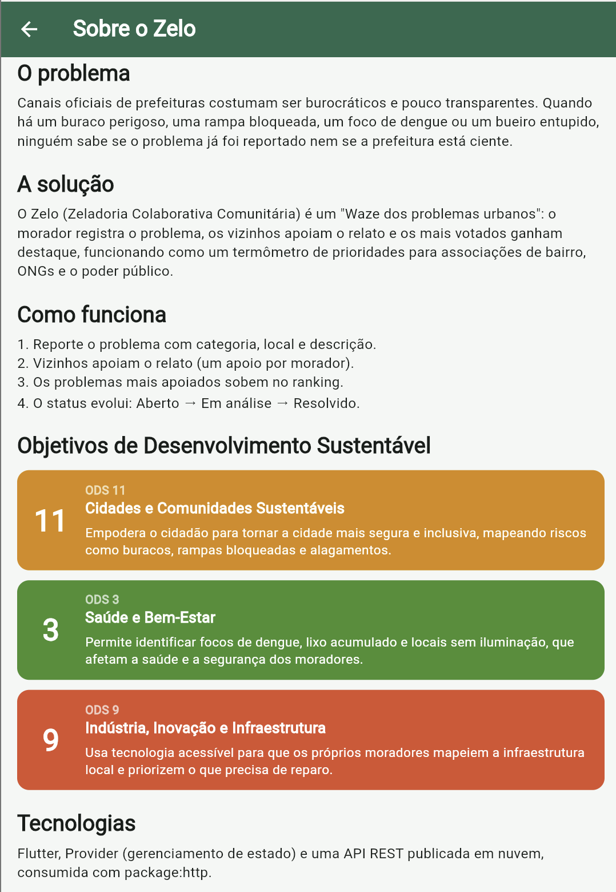

# Zelo — Zeladoria Colaborativa Comunitária

> Global Solution 2026.2 · FIAP · 3º ano de Sistemas de Informação
> Disciplina: Desenvolvimento Cross-Platform com Flutter
> Desafio **CitizenTech**: *a próxima grande inovação pode estar na sua rua*

## 1. Identificação

| Nome completo | RM |
|---|---|
|Carlos Henrique Mirando Villarinho|RM558073|
|Juliana Tami Kanashiro|RM558421|

## 2. Sobre o projeto (CitizenTech & ODS)

**Problema real.** Canais oficiais de prefeituras (como o 156) costumam ser burocráticos e pouco transparentes. Diante de um buraco perigoso, uma rampa de acessibilidade bloqueada, um foco de dengue ou um bueiro entupido, o morador não sabe se alguém já reportou o problema nem se o poder público está ciente.

**Solução.** O **Zelo** é um "Waze dos problemas urbanos": o morador registra o problema, os vizinhos **apoiam** (upvote) o relato e os problemas mais votados ganham destaque, funcionando como um termômetro de prioridades para associações de bairro, ONGs e o poder público. Cada morador vira um sensor da cidade.

**Público-alvo.** Moradores de bairros urbanos, associações de moradores, ONGs e gestores públicos.

**Funcionalidades do MVP**

- CRUD completo de relatos (criar, listar, editar e excluir com confirmação)
- Apoio da comunidade (upvote) com opção de desfazer
- Ranking dos relatos mais apoiados
- Situação do relato: Aberto → Em análise → Resolvido
- Busca por texto e filtros por categoria e situação
- Dashboard com indicadores (total, em aberto, apoios, % resolvidos)
- Funciona no celular (Android/iOS) e também no navegador (Chrome)

**ODS conectados**

| ODS | Relação com o Zelo |
|---|---|
| **11** – Cidades e Comunidades Sustentáveis | Cidadão mapeia riscos e torna a cidade mais segura e inclusiva |
| **3** – Saúde e Bem-Estar | Mapeamento de focos de dengue, lixo acumulado e falta de iluminação |
| **9** – Indústria, Inovação e Infraestrutura | Tecnologia acessível para mapear a infraestrutura local |

## 3. Arquitetura e persistência escolhida

**Opção B – Persistência local com SQLite (`sqflite`).** Nenhum servidor, API ou chave é necessária (execução *zero-config*). O banco é criado automaticamente na primeira execução (`onCreate`) e já recebe uma **carga inicial (seed)** de 8 relatos de exemplo. Todas as operações são assíncronas (`Future`, `async`, `await`).


**Tabela `relatos`**

| Coluna | Tipo | Descrição |
|---|---|---|
| `id` | INTEGER PK AUTOINCREMENT | Identificador |
| `titulo` | TEXT NOT NULL | Título do relato |
| `descricao` | TEXT NOT NULL | Descrição do problema |
| `categoria` | TEXT NOT NULL | buraco, iluminacao, lixo, alagamento, dengue, acessibilidade, outro |
| `bairro` | TEXT NOT NULL | Bairro / local |
| `status` | TEXT NOT NULL | aberto, emAnalise, resolvido |
| `apoios` | INTEGER NOT NULL | Quantidade de apoios (upvotes) |
| `risco` | INTEGER NOT NULL | 1 = oferece risco para pessoas |
| `apoiado` | INTEGER NOT NULL | 1 = este aparelho já apoiou o relato |
| `dataCriacao` | INTEGER NOT NULL | Data de criação (milissegundos) |

**Estrutura de pastas**

```
lib/
├── main.dart                         # MultiProvider + MaterialApp (escolhe o repositório)
├── models/relato.dart                # Relato, CategoriaRelato, StatusRelato
├── services/                         # database_service.dart (SQLite) e seed_data.dart
├── repositories/                     # contrato, SQLite (mobile) e armazenamento local (web)
├── providers/                        # RelatoProvider (ChangeNotifier)
├── screens/                          # Home, Listagem, Formulário, Detalhes, Sobre
├── widgets/                          # componentes reutilizáveis
├── routes/app_routes.dart            # rotas nomeadas e argumentos
├── theme/app_theme.dart              # ThemeData (cores e tipografia)
└── utils/                            # validators, formatters, ods
test/zelo_test.dart                   # testes de unidade (modelo, validações, provider, repositório local)
```

**Conceitos aplicados:** widgets e layouts Material, componentização, `ThemeData`, navegação com rotas nomeadas e argumentos, `Provider` (`ChangeNotifier`, `MultiProvider`, `Consumer`, `context.watch/read`), `async/await` com SQLite e testes de unidade.

## 4. Galeria de telas

> Adicionar os prints do app em execução em `docs/screenshots/` e referenciá-los abaixo.

- Home (Dashboard)



- Listagem (ListView)



- Formulário com validação


- Detalhes


- Sobre / ODS



## 5. Instruções de execução

Pré-requisito: Flutter SDK instalado.

```bash
git clone <URL_DO_REPOSITORIO>
cd gsflutter_zelo
flutter pub get
flutter run                
```

Para executar os testes de unidade:

```bash
flutter test
```

Os relatos de exemplo aparecem sozinhos na primeira execução. Se a lista ficar vazia depois de excluir tudo, use o botão **"Carregar relatos de exemplo"**.